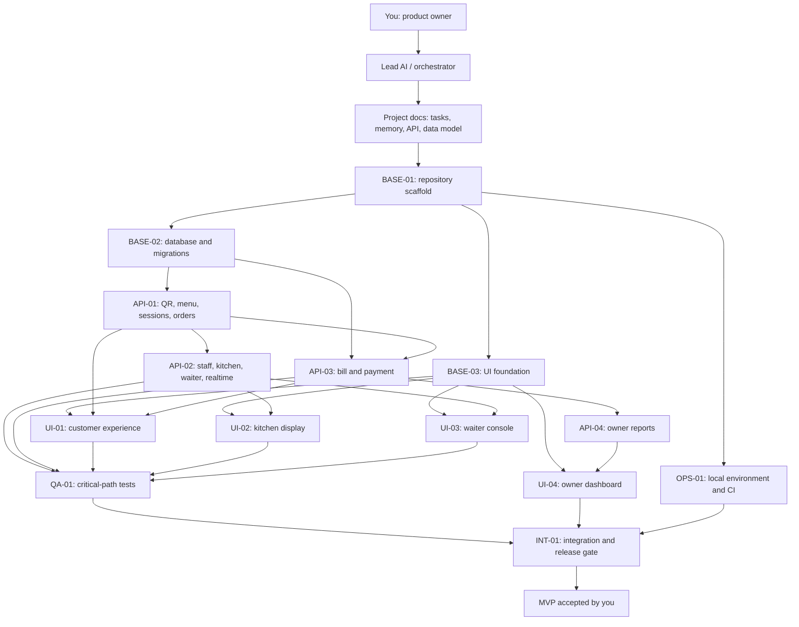

# Agent Coordination Guide

## 1. Understand the difference

**Free-plan rule:** The roles in `tasks.md` are reusable jobs, not 14 separate AI subscriptions. Use one primary coding workspace and assign one bounded task at a time. See `free-plan-workflow.md` for the current free-only tool recommendation.

- **Model:** The AI engine (for example, a GPT, Claude, or Gemini model). Different models have different strengths, context limits, costs, and tool support.
- **Coding tool / workspace:** The app that gives the model access to your repository, terminal, and Git (for example, an IDE assistant or coding CLI).
- **Agent:** A role plus instructions, task scope, allowed files/tools, and expected output. A backend agent and a frontend agent can use the same model.
- **Orchestrator:** The coordinator that assigns tasks, protects shared contracts, reviews changes, merges work, and updates `memory.md`.
- **Repository:** The shared source of truth. Git branches/worktrees isolate simultaneous edits.

You do not need one unique model or product for every role. Reuse the same model for multiple roles when working sequentially. Use different models only when you have a reason, such as a stronger coding model for implementation or a lower-cost model for documentation/review.

## 2. Recommended operating mode

### Beginner mode: one coding AI at a time

You act as product owner and orchestrator. Give one coding assistant one task prompt from `tasks.md`. Let it inspect only the task's context pack, implement the task, run the checks, and report its changes. Review the diff and tests before moving to the next task. This is slower but easiest to control.

### Parallel mode: one coordinator plus two or three workers

Use this only after the repository builds and you are comfortable with Git. Keep one lead/orchestrator session for planning and review. Give each worker a separate branch or Git worktree and a non-overlapping file scope. Never let two workers edit the same files at the same time. Merge only after review and tests.

## 3. Dependency graph



## 4. How to operate each task

1. Read `memory.md` and find the task in `tasks.md`.
2. Check its dependencies. Do not start it before they are complete unless the task explicitly allows mock-based work.
3. Assign exactly one owner (one agent/session) and one branch/worktree.
4. Give the worker the short task prompt and only its listed context files.
5. Ask it to inspect existing code before editing. No silent changes to API, database, money, auth, or event contracts.
6. Worker reports exact files changed, commands run, test results, deviations, and blockers.
7. Review `git diff`; run the relevant checks yourself or through the lead AI.
8. Merge the branch. Only then mark the task `DONE` and update `memory.md`.
9. Assign the next dependent task.

**Important:** `DONE` means reviewed, tested, and integrated. Code that was merely generated is not done.

## 5. Suggested model/tool allocation

For a zero-subscription project, use one repository-enabled free coding workspace (recommended: Antigravity Individual) as the implementer, ChatGPT Free as the browser-based planner/reviewer, and optional GitHub Copilot Student if GitHub Education verifies student status. Do not pay for APIs or rely on paid-only orchestration. Codex CLI with a ChatGPT Free login is an alternative local coding workspace, not an additional required worker. Details and current caveats are in `free-plan-workflow.md`.

| Work | What matters most | Model choice |
|---|---|---|
| Orchestration and architecture | Careful reasoning, consistency, following contracts | Your most reliable reasoning model |
| Backend and database | Coding accuracy, tests, security awareness | Strong coding model with terminal/repo access |
| Frontend UI | React/TypeScript ability, visual iteration | Strong coding model with preview/browser access if available |
| QA/review | Adversarial thinking, test design, diff review | Independent model/reviewer when possible |
| Documentation/content | Clear writing and consistency | Lower-cost capable model is usually sufficient |

Do not assume every model can access your files, run commands, or edit code. Verify the capabilities of the coding tool connected to that model. If the model only chats, use it for planning/review and use a repository-enabled coding tool for implementation.

## 6. Copy-ready universal worker instruction

```text
You are the worker for task <TASK-ID> in this restaurant ordering repository.
Read memory.md, the task card in tasks.md, and only the context files listed for that task. Inspect existing code before editing. Work only within the task's owned files and follow api-contract.md, data-model.md, and agent-workflow.md. Do not silently change shared contracts or edit another worker's files. If blocked, explain the exact blocker and stop instead of inventing an interface. Run focused tests and report: status, changed files, implementation summary, commands/tests and actual results, contract deviations, limitations, and next dependency. Do not claim unrun tests passed.
```

## 7. First actions for this project

1. Put this documentation pack in the repository root so the paths in `tasks.md` resolve.
2. Initialize Git and make a commit containing the documentation baseline.
3. Choose one coding workspace that can read/write the repository and run terminal commands.
4. Start with `BASE-01` only. Do not launch all roles at once.
5. Verify the web app, API health endpoint, and PostgreSQL startup. Review the diff and commit the scaffold.
6. Then do `BASE-02`, `BASE-03`, and `OPS-01`. They can be parallel only if you use separate branches/worktrees and keep file ownership separate; otherwise do them sequentially.
7. Continue through the task dependency graph. Keep `memory.md` updated after every accepted merge.

## 8. Lead AI starter prompt

```text
Act as the project orchestrator, not the feature coder. Read README.md, memory.md, tasks.md, and agent-workflow.md. Explain the next unblocked task and its dependencies. Assign only one task at a time unless I explicitly approve parallel work. Protect shared API/database contracts, require test evidence, review each worker's diff, and update memory.md only after work is verified and merged. Start by preparing BASE-01; do not implement unrelated features.
```
