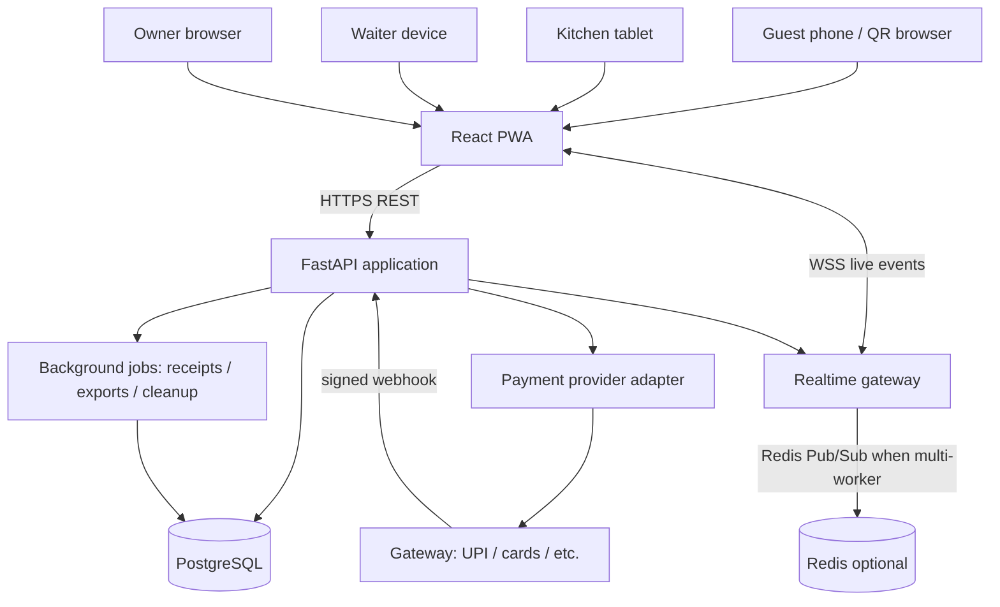

# System Architecture

## 1. Architecture style

Use a **modular monolith**: one FastAPI deployment, one React app, one PostgreSQL database, and clearly separated domain modules. This is the simplest reliable architecture for an MVP. Keep module interfaces clean so high-load or independently scaled modules can be extracted later if evidence justifies it.

## 2. Logical component diagram



`RT` can be part of the FastAPI app initially. Add Redis when multiple API workers or instances require cross-process event fan-out. Do not require WebSocket for commands such as order placement; REST remains authoritative.

## 3. Deployment/runtime modules

### Frontend
- One SPA/PWA with separate layouts and route groups for guest, kitchen, waiter, and owner.
- API client handles auth/session cookies, request IDs, retries for safe reads, and common errors.
- Customer session uses secure server-managed cookie/token; never use a public table QR token as a staff credential.

### Backend modules

| Module | Responsibility | Owns |
|---|---|---|
| Identity & access | Staff login, membership, role and outlet permission checks | Staff principals, permissions |
| Restaurant config | Restaurant/outlet, branding, timezone, tax settings | Tenant/outlet config |
| QR & table | QR token validation/rotation, dining table/session lifecycle | QR credentials, table sessions |
| Menu | Categories, items, options, availability | Current catalog |
| Ordering | Validate cart, place orders, snapshots, status | Orders and order items |
| Service requests | Waiter calls and state transitions | Service requests |
| Kitchen | Queue/filter/station view and ticket transitions | KDS read model/state |
| Billing | Session bill, tax/charge calculation, invoice number | Bill calculation and invoice snapshot |
| Payments | Payment provider adapter, webhook verification, refund recording | Payment lifecycle |
| Reporting | Owner metrics and exports | Read-only aggregate queries |
| Audit | Record sensitive administrative/payment actions | Audit entries |
| Realtime | Publish authorized outlet/session events | WebSocket channels |

Keep domain logic in services; routers should validate input, call services, and serialize responses. Avoid business rules inside React components or ORM event hooks.

## 4. Tenant and outlet boundaries

- `restaurant` is the tenant/brand; `outlet` is a physical operating location.
- Every operational record references `outlet_id`; outlet belongs to `restaurant_id`.
- Staff memberships define allowed outlets and role(s).
- All service/repository queries enforce outlet scope. Do not rely on frontend route IDs.
- Initial deployment can provision one restaurant and one outlet. Schema and access rules must not assume global single-restaurant data.

## 5. Primary domain flows

### QR → session → order
1. QR token maps to an active table/outlet; server returns safe public restaurant/table/menu data.
2. Server creates or resumes the table's open session and issues a guest session credential.
3. Guest adds items in UI; before placement backend reloads current item prices/options/availability.
4. Backend validates item selections and quantity, computes line totals/tax, stores immutable item snapshots, and creates order in one DB transaction.
5. `order.created` event is published to the authorized kitchen outlet/station and to the guest session.

### Kitchen updates
1. Kitchen staff authenticates and selects an authorized outlet/station.
2. KDS fetches current queue through REST and subscribes to outlet events.
3. Staff action calls a validated state-transition endpoint.
4. Backend records actor/time, commits status, and emits `order.status_changed`.

### Waiter call
1. Guest posts a service request bound to its active session.
2. Backend rate-limits and stores request; emits `service_request.created` to waiter channel.
3. Waiter acknowledges/resolves with authenticated staff identity; backend logs state and emits update to guest and waiter.

### Bill and payment
1. Backend aggregates all non-cancelled billable orders in the open table session.
2. A checkout transaction locks the session, calculates exact balance, and creates pending payment intent/order.
3. Frontend opens provider checkout using safe public fields.
4. Provider sends a signed webhook; backend verifies signature, amount, currency, provider order/payment IDs, and idempotency.
5. On verified capture, backend records payment, closes session if balance is settled, creates receipt/invoice snapshot, and emits `payment.updated` / `session.bill_updated`.
6. Failed/expired attempt releases checkout lock and leaves bill open.

### Owner reports
- Queries aggregate paid/captured payments and order snapshots for selected outlet/time range.
- Default time grouping uses outlet timezone; persist timestamps in UTC.
- Report response documents included/excluded statuses and tax treatment.

## 6. State machines

### Order

```text
PLACED → ACCEPTED → PREPARING → READY → SERVED
   └──────────────→ CANCELLED (only if policy/permission permits)
```

Transitions are backend-enforced. Do not allow a client to jump arbitrary states. A more detailed implementation may permit `PLACED → PREPARING` if kitchen workflows need it, but document it in the API contract first. Item-level preparation state is a later extension unless required for the first pilot.

### Table session

```text
OPEN → CHECKOUT_PENDING → CLOSED
          └── failure/expiry → OPEN
```

No new guest orders during `CHECKOUT_PENDING` for MVP. Session cannot close until the amount due is zero and payment/authorized cash collection is recorded. Staff-only exceptional close requires permission and audit reason.

### Service request

```text
OPEN → ACKNOWLEDGED → RESOLVED
```

A request cannot be resolved twice; duplicate commands are idempotent where possible.

### Payment

```text
CREATED → PENDING → CAPTURED
                   ├→ FAILED
                   └→ CANCELLED / EXPIRED
CAPTURED → PARTIALLY_REFUNDED → REFUNDED
```

Payment state is separate from order state. Refunds require an authorized workflow and audit entry.

## 7. Transaction and consistency rules

- Place-order transaction: validate session; load current menu/options; compute price; create order + items + snapshots; store idempotency result; commit; then publish event (prefer transactional outbox when reliability requirement increases).
- Checkout transaction: lock table session row; calculate remaining balance; prevent duplicate active checkout; persist payment attempt; commit.
- Webhook transaction: verify signature before state update; unique provider event/payment IDs; lock payment row; apply state once; update session state; commit; enqueue/publish event.
- Use DB constraints for unique QR token hash, invoice number per outlet, provider transaction ID, and idempotency scope.
- Keep timestamps in UTC; convert only for display/report grouping.

## 8. Integrations and adapters

- Payment: `PaymentGateway` interface with methods to create provider order/checkout, verify webhook, and normalize provider event. Keep provider SDK and secrets in adapter module.
- Media: object storage/CDN adapter for restaurant logo/menu images; local filesystem only in development.
- Email/SMS/WhatsApp: not needed for MVP; add only with explicit product scope and consent.
- Receipts: HTML/PDF generation after payment confirmation; do not block order placement.

## 9. Suggested monorepo layout

```text
restaurant-order-system/
├── apps/
│   ├── web/
│   │   └── src/
│   │       ├── app/                  # router, providers, route guards
│   │       ├── components/ui/        # shared primitives
│   │       ├── features/
│   │       │   ├── guest/
│   │       │   ├── kitchen/
│   │       │   ├── waiter/
│   │       │   └── owner/
│   │       ├── services/             # API client, auth/session
│   │       └── styles/
│   └── api/
│       └── app/
│           ├── api/v1/               # route registration only
│           ├── core/                 # config, security, errors
│           ├── db/                   # engine, session, models, migrations
│           ├── modules/
│           │   ├── identity/
│           │   ├── restaurants/
│           │   ├── menu/
│           │   ├── tables/
│           │   ├── orders/
│           │   ├── service_requests/
│           │   ├── kitchen/
│           │   ├── billing/
│           │   ├── payments/
│           │   ├── reports/
│           │   └── audit/
│           └── realtime/
├── docs/                              # optional copy of this blueprint
├── docker-compose.yml
├── .env.example
└── README.md
```

## 10. Architecture non-goals

No microservices, Kafka, Kubernetes, event sourcing, GraphQL, native apps, or complex multi-region topology for MVP. Add infrastructure only when a measured requirement justifies it.
