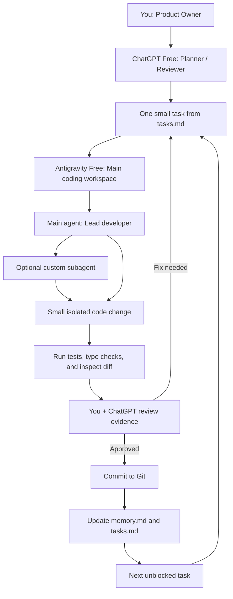

# Free-Plan Development Workflow

**Applies to:** Restaurant QR ordering and billing project  
**Budget rule:** ₹0 subscription spend and ₹0 API spend  
**Checked:** 2026-11-02  

## 1. The key rule

The 14 entries in `tasks.md` are **work roles**, not 14 separate AI subscriptions. Reuse the same coding AI for different roles by giving it one bounded task and the correct context files. Start with one worker. Use at most two concurrent workers until the repository, tests, Git workflow, and shared contracts are stable.

## 2. Recommended free tool setup

### Primary coding workspace: Google Antigravity Individual

- The Individual plan is listed at $0/month and includes a variety of agent models, unlimited tab completions, unlimited command requests, and basic weekly rate limits.
- Use Antigravity as the one place that can inspect the repository, edit files, use the terminal, and run tests.
- Custom subagents are documented for the Antigravity App and CLI. Use them only for short, independent tasks and only if the feature is available in your free account.
- Do not rely on `/teamwork` or `/boost`: the current documentation marks these advanced orchestrators as paid-plan features.
- Keep concurrency low: one main agent plus one worker at most initially. Parallel work consumes quota faster and increases merge risk.

Official references:
- https://antigravity.google/pricing
- https://antigravity.google/docs/subagents/

### Planning and independent review: ChatGPT Free

Use ChatGPT in the browser for:
- clarifying requirements and architecture decisions;
- producing small task prompts;
- explaining errors and stack traces;
- reviewing a concise Git diff or test report;
- checking whether the implementation follows `api-contract.md`, `data-model.md`, and `security.md`.

ChatGPT browser conversations do not automatically see the local repository. Paste the relevant diff, error, or small set of files when asking for review. Avoid uploading the entire project repeatedly. Free-plan file uploads and project file counts are limited and may change.

### Optional local coding alternative: Codex CLI with ChatGPT Free

Codex is included on ChatGPT Free with plan-dependent usage limits. Codex CLI can work against a local repository, and its current documentation describes agent view, multi-agent tools, and Git worktrees. Codex Cloud is not included on Free.

Use Codex CLI **instead of Antigravity**, not alongside it as a second primary IDE, if you prefer terminal-first coding. Sign in with your ChatGPT account; do not add an API key. Check `/status` and the usage dashboard when limits appear.

Official references:
- https://help.openai.com/en/articles/11369540-using-codex-with-your-chatgpt-plan
- https://learn.chatgpt.com/docs/codex/cli

### Optional student benefit: GitHub Copilot Student

Because this is a student project, apply for GitHub Education using your current institutional proof. Verified students can activate Copilot Student at no charge. Treat it as IDE assistance/autocomplete, not as a required autonomous cloud-agent service. Student eligibility is re-evaluated periodically and AI-credit allowances still apply.

Official references:
- https://docs.github.com/en/copilot/how-tos/copilot-on-github/set-up-copilot/enable-copilot/set-up-for-students
- https://docs.github.com/en/education/about-github-education/github-education-for-students/about-github-education-for-students

### Optional second opinion: Claude Free

Use Claude Free occasionally to critique a small diff, review a design decision, or propose edge cases. It is not required for implementation. Do not assume the Claude Free chat plan includes Claude Code or Anthropic API credits.

Official references:
- https://claude.com/pricing
- https://support.claude.com/en/articles/11647753-how-do-usage-and-length-limits-work

## 3. What not to depend on

- Do not buy or add OpenAI, Anthropic, or Google API credits. Consumer chat subscriptions and API billing are separate products.
- Do not put an API key into OpenCode or another coding client unless you have verified that the provider and key are genuinely free and have a hard spending cap. A coding client is not itself a free model.
- Do not use paid-only cloud agents or premium orchestration features as a project dependency.
- Do not launch 14 agents. More workers mean more context, quota consumption, merge conflicts, and review work.
- Gemini CLI / Gemini Code Assist consumer Google-account access was discontinued on 2026-06-18; Google's migration direction is Antigravity. Do not follow old setup guides that promise the previous consumer Gemini CLI login.

Reference:
- https://developers.google.com/gemini-code-assist/docs/deprecations/code-assist-individuals

## 4. Recommended operating model



### Free-tier concurrency rule

| Project stage | Concurrent coding agents | Why |
|---|---:|---|
| Before BASE-01 works | 1 | Establish the repository and prevent conflicting setup edits |
| After scaffold and Git are stable | 1–2 | Use a separate branch/worktree for each worker |
| During UI/backend feature work | 1–2 | Keep free quota and review work manageable |
| Integration, payments, security | 1 | Avoid concurrent changes to critical shared behavior |

Do not assume a fixed number of prompts is guaranteed. Antigravity's free allowance is a basic weekly quota and product limits may change. Codex and Claude free allowances are also plan-dependent or variable.

## 5. Reuse roles instead of creating agents

| Role from `tasks.md` | Reuse which worker? | When |
|---|---|---|
| Orchestrator / architect | Main Antigravity agent | Every task; owns integration order |
| Scaffold / deployment | Same coding worker | BASE-01 and OPS-01, sequentially if files overlap |
| DB / backend / billing / reports | Same backend worker | One task per session; follow dependencies |
| UI foundation / customer / kitchen / waiter / owner | Same frontend worker | Separate task prompts; shared foundation first |
| QA / security reviewer | Main agent plus ChatGPT or Claude Free | Review-only pass; do not let reviewer silently edit production code |
| Integration lead | Main agent + you | After each accepted milestone |

A role changes when the task prompt changes. The model does not have to change.

## 6. Exact daily workflow

1. Open the repository in Antigravity.
2. Ask the main agent to read `memory.md`, the single relevant task card in `tasks.md`, and only that task's listed context files.
3. Ask it to state dependencies, owned files, and acceptance checks before coding.
4. Assign one task only. Initially, do not spawn subagents.
5. Inspect the proposed plan and approve commands/file edits where needed.
6. Ask the agent to implement, run the focused tests, and show the Git diff.
7. Review the diff yourself. Ask ChatGPT Free to critique only the important diff or test output if helpful.
8. Commit only after tests and review. Mark the task `DONE` only after integration.
9. Update `memory.md` and `tasks.md` with actual files, test results, known gaps, and next task.
10. When the task is complete, stop. Do not ask the same agent to build the next five modules in one prompt.

## 7. Copy-ready main-agent prompt

```text
You are the lead coding agent for this repository. We are using free plans only: do not request API keys, paid subscriptions, paid credits, or paid cloud-agent features.

Read README.md, memory.md, tasks.md, and agent-coordination.md. Then read only the context files listed for the next unblocked task. The task roles in tasks.md are reusable jobs, not separate AI accounts.

Start with BASE-01 only. Inspect the repository first. State the files you will own, dependencies, plan, and acceptance checks. Do not spawn subagents yet. Implement only BASE-01, run the checks, show the Git diff, and report exact test results. Do not claim a test passed unless you ran it. Do not change api-contract.md or data-model.md silently. Update memory.md and tasks.md only after the work is verified and committed.
```

## 8. First things to do

1. Choose Antigravity Individual as the only primary coding IDE, or choose Codex CLI instead if you prefer terminal-first work. Do not set up both as primary tools.
2. Keep ChatGPT Free open for planning and code review.
3. Apply for GitHub Education / Copilot Student if eligible; do not block project progress on approval.
4. Extract this documentation pack into the repository root and initialize Git.
5. Start BASE-01. Do not create the full application until the scaffold, local database, and health checks work.

## 9. Cost boundary

This workflow targets zero AI subscription and API spend. It does **not** guarantee the deployed restaurant product can run in production at zero cost. Hosting, database capacity, domain registration, SMS/WhatsApp, payment gateway charges, backups, and operational support may eventually cost money. Start locally and use payment-provider sandbox credentials during development. Never use real customer payment data in local tests.
